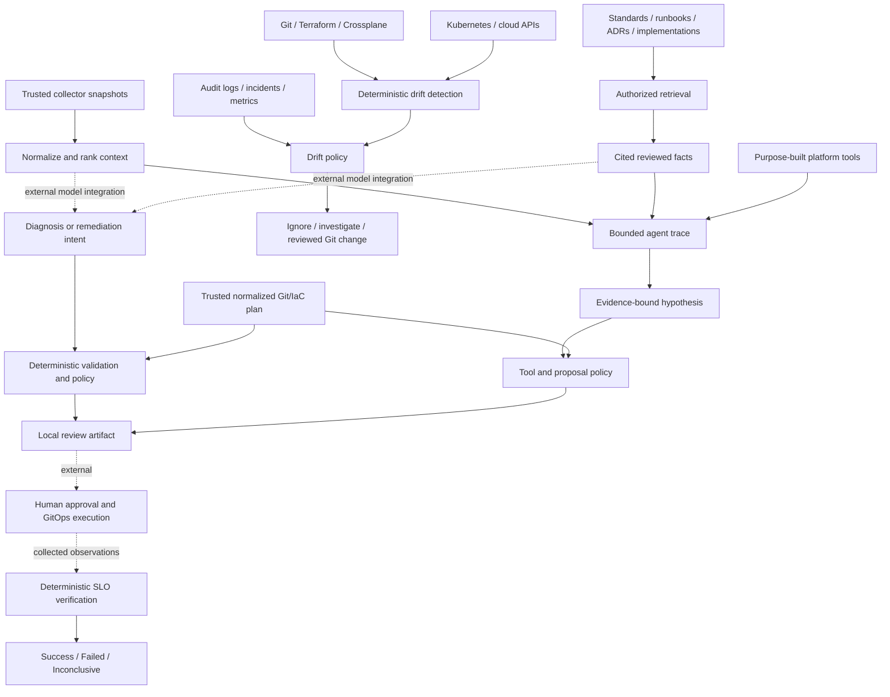

# Architecture and safety

[Back to README](../README.md)

The project is a local reference implementation for reviewing AI-proposed incident
remediation. It consumes structured JSON; it does not call an LLM, query live
observability systems, or execute production changes.

## Implemented capabilities

| Stage | Capability | Guide |
| --- | --- | --- |
| 1 | Structured diagnosis validation and rollback policy | [Triage](01-stage-1-triage.md) |
| 2 | Read-only context normalization and evidence ranking | [Context](02-stage-2-context.md) |
| 3 | Remediation intents, risk checks, plan comparison, and review artifacts | [Remediation](03-stage-3-remediation.md) |
| 4 | Contract-based SLO verification and error-budget approval tiers | [Verification](04-stage-4-verification.md) |
| 5 | Provenance-aware configuration and infrastructure drift intelligence | [Drift intelligence](05-stage-5-drift-intelligence.md) |
| 6 | Authority-aware retrieval with citations and contradiction detection | [RAG platform copilot](06-stage-6-rag-platform-copilot.md) |
| 7 | Typed, bounded tool traces with authorization and intent-to-plan validation | [Tool-using agents](07-stage-7-tool-using-agents.md) |

## Safety model

- Collector input is read-only and normalized before it reaches a reasoning layer.
- Diagnoses are schema-validated before policy evaluation.
- Confidence below `0.80` is routed to investigation.
- Rollbacks require human approval and result in a GitOps change proposal, never a direct production action.
- Actions outside the permitted policy default to no change.

The application has no Kubernetes credentials, `kubectl` integration, or production
mutation capability. All supported change proposals require human approval.
Verification never initiates a rollback.
Drift review never reconciles a live resource or edits desired state. It emits a
review artifact, and all proposed Git changes require external human approval.
Retrieval emits cited facts rather than executable instructions. Raw document text
remains untrusted, and grounded recommendations still pass through existing policy.
Agent review accepts only purpose-built tools with exact schemas. It rejects raw
shell and infrastructure primitives, enforces service and environment scope, binds
results to calls, and emits proposals rather than executing them.

## Integration boundaries

Collectors must supply fresh, authenticated facts independently of model output.
The local CLIs cannot authenticate the provenance of files. An external approval
service must bind approval to the exact intent, context, plan, repository revision,
and verification contract, then submit changes through the owning controller.

Model invocation, live metrics queries, raw Terraform/Kubernetes plan adapters,
RBAC, authenticated approvals, PR creation, and controller execution are external
integration work. The architecture diagram shows where those systems would connect;
it does not imply those integrations are implemented.

Drift collectors must also authenticate audit actors, controller ownership,
incident linkage, and resource semantics. A model cannot declare its own evidence
trusted, mark a destructive reversal safe, or grant approval.

RAG metadata, access scopes, document review state, and extracted facts must be
provided by authenticated ingestion and identity systems. The local retriever can
validate their shape but cannot establish their provenance or authenticate a user.

The Stage 7 evaluator reviews a supplied trace; it does not invoke the tools. A real
platform tool API must authenticate the principal, enforce ownership and data-access
policy, redact secrets, cap queries and results, and produce immutable audit records.
PR creation, plan generation, approval binding, and controller execution remain
external. The full plan must be trusted and complete before policy can compare it
with the agent's single proposed change.

See the [trust and integration contract](03-stage-3-remediation.md#trust-and-integration-contract)
for plan completeness and approval requirements. Successful mitigation is separate
from root-cause resolution and from meeting the service's long-term SLO; see the
[memory example](04-stage-4-verification.md).
