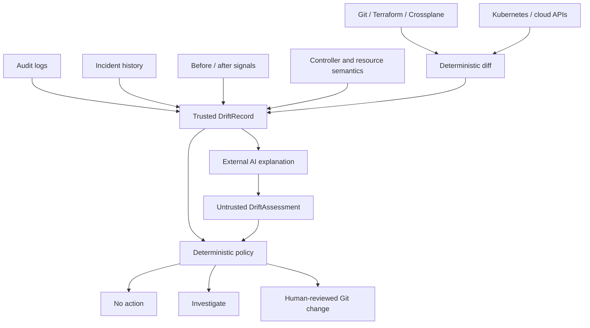

# Stage 5: configuration and drift intelligence

[Back to README](../README.md)

Stage 5 separates deterministic drift detection from semantic explanation and
change authority. Desired and observed values can differ because of an accident,
an incident mitigation, a controller adjustment, or expected provider behavior.
The same `desired != observed` result can therefore require opposite actions.



The local implementation consumes two JSON documents. `DriftRecord` is trusted,
normalized collector input. It contains the exact field difference, provenance,
incident state, reconciliation status, resource semantics, and before/after
reliability signals. `DriftAssessment` is untrusted AI output containing a
classification, confidence, suggested action, risk, and supporting evidence.
Strict schemas reject extra fields, malformed timestamps, non-finite metrics, and
unsupported actions.

Run the emergency memory example:

```bash
make drift PYTHON=.venv/bin/python
```

The policy returns `EMERGENCY_DRIFT`, `BACKPORT_TO_GIT`, and
`requires_human_approval`. An on-call SRE increased the memory limit while an
incident was active, Argo CD reconciliation was disabled, and both OOMKills and
HTTP errors improved. Reverting the cluster to stale Git state could recreate the
outage, so the reviewed production value should be back-ported before automatic
reconciliation is restored. The artifact requires incident-commander approval;
the CLI does not edit Git or enable Argo CD.

## Exercise cases

| Case | Trusted meaning | Policy result |
| --- | --- | --- |
| A: HPA changes replicas 5 → 8 under high CPU | Expected controller runtime state | `CONTROLLER_STATE` → `IGNORE` |
| B: GKE max nodes changes 10 → 20 with no incident or ticket | Suspicious manual change | `ACCIDENTAL_DRIFT` → `INVESTIGATE` |
| C: SRE changes memory 1Gi → 2Gi during an outage and reliability improves | Emergency operational drift | `EMERGENCY_DRIFT` → `BACKPORT_TO_GIT` with approval |
| D: provider expands storage 500Gi → 650Gi automatically | Expected, irreversible provider behavior | `EXPECTED_DRIFT` → review `UPDATE_DESIRED_STATE` |

Run any case directly by pairing its record and assessment:

```bash
PYTHONPATH=src python3 -m incident_copilot.drift_cli \
  --record examples/drift/a-hpa-record.json \
  --assessment examples/drift/a-hpa-assessment.json
```

Replace `a-hpa` with `b-manual`, `c-emergency`, or `d-provider`. CLI exit codes are
`0` for `no_action` or a complete proposal requiring human approval, `1` for
`investigate`, and `2` for malformed input. Exit code `0` is not permission to
change infrastructure.

## Policy boundaries

The policy derives the permitted classification, action, and reconciliation risk
from trusted facts. Confidence below `0.80`, or an AI assessment that conflicts
with those facts, produces `UNKNOWN` and `investigate`. A model cannot relabel an
emergency change as accidental drift, lower its risk, or request immediate
reconciliation. Emergency drift is recognized only when a manual change occurred
during an incident and at least one declared reliability signal improved without
another signal regressing.

Expected controller adaptation requires a trusted controller source and explicit
runtime-adaptation semantics. Expected provider behavior can propose updating
desired state, but still requires a platform-owner review. When a reverse operation
is destructive or unsupported, as with storage shrink, the result explicitly warns
against reverting observed state.

Production integrations must compute the diff outside the model, authenticate and
freshness-check every source, normalize complete plans, and bind approval to the
record, assessment, repository revision, and generated Git change. This reference
implementation does not query Kubernetes, cloud APIs, audit logs, incident systems,
or observability platforms. It never runs `kubectl`, Terraform, Crossplane, or a
cloud mutation.
