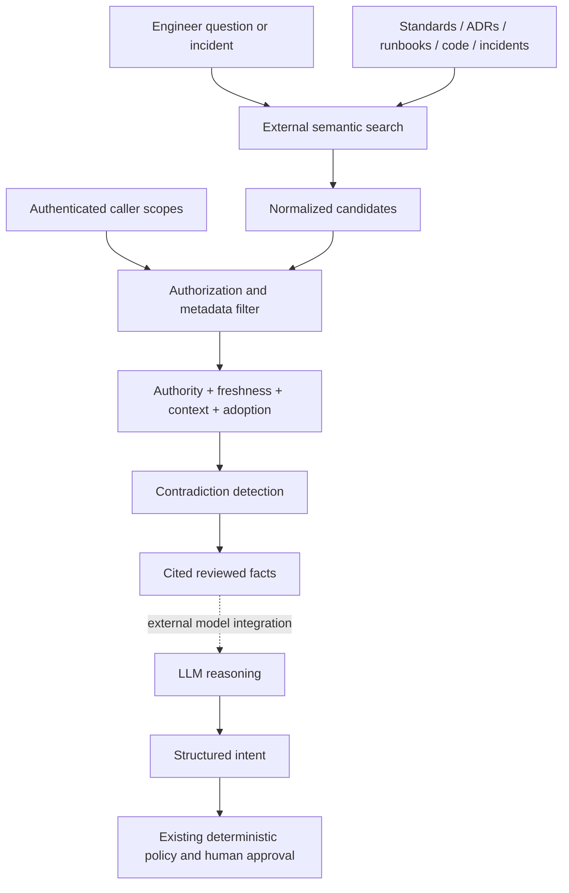

# Stage 6: RAG platform copilot

[Back to README](../README.md)

Stage 6 adds organizational knowledge to the reliability loop. A technically valid
answer can still violate a platform standard, use a deprecated workflow, or ignore
a known failure mode. The retriever therefore combines externally computed semantic
similarity with deterministic access, authority, freshness, service, environment,
and adoption controls.



The local implementation does not run an embedding model or call an LLM. An
external search adapter supplies a bounded `similarity` score for each candidate.
The deterministic layer then computes:

```text
score = similarity × authority × status × freshness × service × environment
```

Production adoption can raise the authority of a live module or composition, up
to a fixed cap. Approved standards and decisions carry more weight than historical
postmortems, debug notes, or chat. Deprecated documents are excluded even when
their similarity is high. Documents outside the authenticated caller's scopes are
filtered before ranking.

## Ground the memory question

Run the checkout example:

```bash
make rag PYTHON=.venv/bin/python
```

The result is `grounded`. It ranks the current checkout runbook and approved
Kubernetes standard above the other sources, then includes the VPA recommendation
and historical postmortem as supporting evidence. The context packet establishes:

- Production resource changes must use GitOps.
- Historical memory is 600–750Mi and sustained usage above 900Mi needs investigation.
- VPA currently recommends about 1.3Gi.
- A previous release developed a memory leak.

The highly similar “bump it to 2Gi” chat message and temporary debug note fall below
the authority threshold. A restricted security standard is excluded because the
example caller lacks its scope. This evidence supports inspecting memory trends,
OOMKills, and the latest deployment before proposing the smallest justified Git
change; the retrieval result itself does not authorize that change.

## Surface disagreement instead of guessing

Run the database example:

```bash
PYTHONPATH=src python3 -m incident_copilot.rag_cli \
  --query examples/rag/database-contradiction-query.json \
  --documents examples/rag/database-contradiction-documents.json
```

The approved standard says Terraform while the current Crossplane Composition,
used by 80% of production services, shows Crossplane. Both facts have strong source
scores, so the result is `investigate` and cites both values. It does not silently
choose documentation or deployed reality. The deprecated Jenkins procedure is
excluded regardless of its `0.99` similarity.

## Contracts and security boundary

Each query declares the target service and environment, an `as_of` date, a bounded
`top_k`, and externally authenticated access scopes. Each document has identity,
type, ownership, version, status, review date, required scopes, similarity,
production adoption, raw content, and reviewed structured facts. Unknown fields,
future review dates, invalid scores, duplicate scopes, unsupported fact types, and
duplicate document IDs are rejected.

Raw document content is untrusted data and is never copied into the context packet.
Only normalized facts, ranking metadata, and versioned citations cross the boundary.
The example debug note contains an indirect prompt injection that requests credential
exfiltration; neither the instruction nor its URL appears in output. Production
ingestion must sandbox extraction, validate facts, authenticate metadata, scan for
secrets, enforce document-level access, and retain source hashes for audit.

CLI exit codes are `0` for `grounded`, `1` for `investigate` or
`insufficient_context`, and `2` for malformed input. A grounded result is evidence
for a model, not an execution credential. Any downstream remediation still requires
the Stage 3 plan comparison, human approval, Stage 4 verification, and relevant
Stage 5 drift checks.

Continue with [Stage 7: tool-using platform agents](07-stage-7-tool-using-agents.md).
