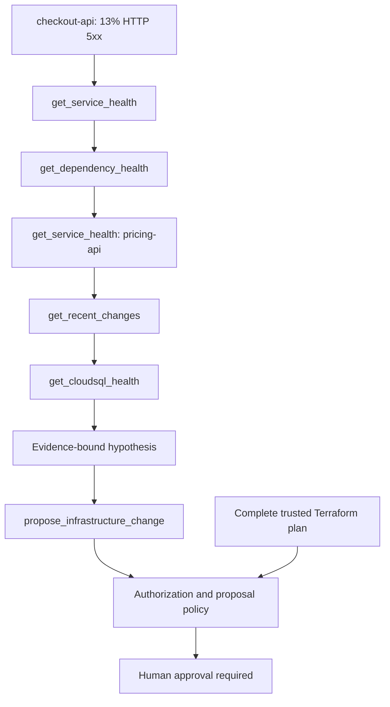

# Stage 7: tool-using platform agents

[Back to README](../README.md)

Stage 7 reviews an agentic incident investigation without giving the model shell,
cloud, Kubernetes, or Terraform credentials. The agent can use a small catalog of
typed platform capabilities. Deterministic code validates each call and result,
binds the final hypothesis to successful evidence, and compares a single proposal
with the complete trusted infrastructure plan.

The local implementation reviews a supplied JSON trace. It does not invoke tools,
query production, create a pull request, approve a change, or run Terraform.

## Investigation flow



The synthetic trace correlates these facts:

- `checkout-api` has 13% HTTP 5xx and 3.9-second p99 latency.
- `pricing-api` is the unhealthy dependency, with 5.1-second p99 latency.
- Pricing database latency is 4.8 seconds while application CPU remains low.
- Terraform recently changed Cloud SQL `max_connections` from 500 to 300.
- Cloud SQL uses 298 of 300 connections and waits 3.9 seconds for a connection,
  while CPU is 34% and query latency is 110 ms.

The evidence points to connection acquisition contention. It does not support a
CPU increase: database compute and query execution are not the observed bottleneck.
The proposal therefore restores `cloudsql.max_connections` from 300 to 500.

## Purpose-built tool catalog

| Tool | Capability | Policy |
| --- | --- | --- |
| `get_service_health` | Read a service health summary | Authorized service and environment only |
| `get_dependency_health` | Read dependency status | Authorized service and environment only |
| `get_recent_changes` | Read normalized change history | Maximum 60-minute window |
| `get_cloudsql_health` | Read a cataloged database summary | Cataloged resource only |
| `get_logs` | Read bounded, redacted log entries | Scoped query, window, item, and byte limits |
| `propose_infrastructure_change` | Express one field update as intent | Owned service, allowed field, evidence, and plan required |
| `request_service_restart` | Request a service-level restart | Owned service, incident, reason, evidence, and approval required |

There is no `shell(command)`, `kubectl(command)`, `gcloud(command)`, direct restart,
or Terraform apply tool. `request_service_restart` accepts platform intent instead
of namespace and deployment primitives, so an external platform API can resolve
ownership, restart policy, blast radius, disruption budgets, and current SLO state.

## Run the example

```bash
make agent PYTHON=.venv/bin/python
```

The result has `decision: requires_human_approval`, approval tier `senior`, an
ordered audit record for all six calls, and the exact normalized Terraform change.
To see the plan gate before plan generation, omit `--plan`:

```bash
PYTHONPATH=src .venv/bin/python -m incident_copilot.agent_cli \
  --context examples/agent/pricing-incident-context.json \
  --run examples/agent/pricing-investigation-run.json
```

That returns `requires_plan`. Supplying
`examples/agent/unexpected-terraform-plan.json` returns `deny` because the plan
contains an additional deletion. The invariant is exact: a one-change intent may
proceed to approval only when the complete plan contains that one change and
nothing else.

## Enforced boundaries

The trusted context declares the authenticated principal, incident, environment,
readable services, services the principal may propose changes for, granted tools,
resource catalog, allowed fields, and request limits. The evaluator then enforces:

- at most 20 steps and a platform-capped 60-minute observation window;
- exact argument and result schemas with no unknown fields;
- unique call IDs and results bound to the matching call, source, and target;
- service ownership, environment, resource, and field authorization;
- bounded log queries with required secret-redaction attestation;
- result item and byte limits, with truncated reads excluded from evidence;
- a hypothesis whose evidence IDs refer to successful read calls;
- at least three successful reads and confidence of at least `0.80` before proposal;
- one proposal as the final step, marked `proposal_only` and tied to the incident;
- infrastructure values supported by both resource health and change evidence;
- a complete plan that exactly matches the proposed update;
- human approval after all automated checks pass.

Every accepted call produces an ordered audit entry with its call ID, tool, trusted
source, and observation timestamp. In production, the tool service must generate
and persist the authoritative audit record; the local file cannot prove provenance.

## Integration contract

A production integration places authentication, authorization, scope validation,
redaction, rate and size limits, and audit logging inside the platform tool API.
The model selects capabilities, but cannot widen their scope or grant itself access.
Collectors must authenticate tool results and freshness independently of model
output. Plan generation must return a complete normalized plan from the owning
controller, and approval must be bound to the incident, evidence, intent, plan, and
repository revision before CI/CD can execute anything.

CLI exit codes are `0` for `requires_plan` or `requires_human_approval`, `1` for
`deny` or `investigate`, and `2` for malformed input.

Continue with [multi-hypothesis incident investigation](08-stage-8-multi-hypothesis-investigation.md).
