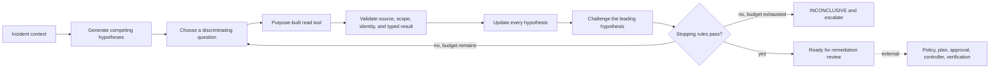

# Stage 8: multi-hypothesis incident investigation

[Back to README](../README.md)

Stage 8 prevents the copilot from anchoring on the first plausible explanation. It
requires multiple hypotheses, asks each read-only tool call to discriminate between
them, records a complete confidence update after every result, and deliberately
tries to falsify the leading cause before stopping.

The evaluator reviews a supplied trace. It does not invoke tools, trust confidence
labels on their own, approve a remediation, or change production.

## Investigation loop



## Checkout example

The synthetic incident begins at 18:51 with an 18% HTTP 5xx rate and 5.8-second
p99 latency. Three recent events could explain it: application version `v2.21`, a
node-pool autoscale, and a Cloud SQL `max_connections` reduction from 500 to 300.

The initial distribution preserves that uncertainty:

| ID | Hypothesis | Initial confidence |
| --- | --- | ---: |
| H1 | Application regression in `v2.21` | 0.35 |
| H2 | Database connection exhaustion | 0.35 |
| H3 | Node contention | 0.15 |
| H4 | Dependency degradation | 0.15 |

The four selected reads maximize discrimination instead of collecting everything:

1. `compare_versions` finds both versions similarly degraded, weakening H1.
2. `get_cloudsql_health` finds 299 of 300 connections used and 4.5-second waits,
   while database CPU and query latency remain normal.
3. `get_recent_changes` identifies the 500-to-300 connection-limit reduction.
4. `get_connection_timeline` challenges H2: demand was already 361–374 connections
   before the change, then usage hit 299 of 300, waits rose, and errors followed.

H2 survives that falsification attempt at confidence `0.94`. The output recommends
restoring the previous value, but routes that recommendation only to remediation
review. It does not carry approval or execution authority.

The payments challenge follows the same method across more layers. Similar latency
on old and new `payments-api` pods weakens an application regression. Healthy query
and connection-wait metrics weaken database saturation. A trace attributes 3.8 of
4.1 seconds to `fraud-service`; its 97% CPU and nine pods pending for insufficient
CPU then point to lost cluster capacity after a node replacement. The investigation
has moved from the original alert through a dependency and Kubernetes scheduling to
the infrastructure event, without treating event proximity as proof.

Run the example:

```bash
make investigate PYTHON=.venv/bin/python
```

Or invoke the CLI directly:

```bash
PYTHONPATH=src .venv/bin/python -m incident_copilot.investigation_cli \
  --context examples/investigation/checkout-incident-context.json \
  --run examples/investigation/checkout-investigation-run.json
```

## Enforced contracts

The trusted context supplies incident scope and a platform-owned budget. The run
must then satisfy these rules:

- at least three unique hypotheses with confidences summing to one;
- exact call and result schemas for four narrow, read-only tools;
- service, environment, database-resource, call-ID, result-source, and target binding;
- a question that discriminates between at least two hypotheses for every read;
- a continuous confidence chain that updates every hypothesis and still sums to one;
- independently cited evidence sources rather than repeated labels from one source;
- deterministic evidence for similar version health, connection saturation, the
  configuration change, and the change-to-impact timeline;
- a deliberate falsification test against the final primary hypothesis;
- a final causal change that exactly matches its cited change-audit record;
- a recommendation that reverses that change and has measurable verification criteria.

The published budget allows 12 tool calls and five minutes, requires confidence
strictly above `0.90`, and requires at least three independent evidence sources.
Platform maximums cap any supplied policy at 20 calls and 15 minutes.

## Stopping behavior

`ready_for_remediation_review` requires every condition below:

- primary confidence exceeds the configured threshold;
- the causal change and temporal sequence are present;
- each competing hypothesis was tested and no competitor remains above `0.10`;
- the primary hypothesis survived a deliberate falsification attempt;
- enough independent cited sources support the result;
- the recommendation includes verification criteria;
- neither time nor tool-call budget was exceeded.

If any condition is missing, or the budget expires, the result is `inconclusive`.
The artifact retains ranked hypotheses, lists the missing conditions, and recommends
escalation. This prevents urgency, confidence formatting, or exhausted budgets from
forcing a remediation. Malformed or cross-scope input is rejected with exit code `2`.
An expired run may set `final_assessment` to `null`; the evaluator will preserve the
last confidence distribution rather than requiring the model to invent a cause.

## Production integration boundary

Authenticated platform services must execute the reads and attest result provenance.
The local JSON file demonstrates the contract but cannot prove that metrics, audit
records, timestamps, or source identities are genuine. A production evidence
planner should select calls by expected information gain and retain immutable audit
records for each confidence update.

The recommendation must pass the Stage 3 remediation policy and complete-plan
comparison, external human approval, Git/IaC controller, and Stage 4 SLO verification.
Budget exhaustion should send the top hypotheses and missing evidence to an operator.

Continue with [agent observability and evaluation](09-stage-9-agent-observability-and-evaluation.md).
