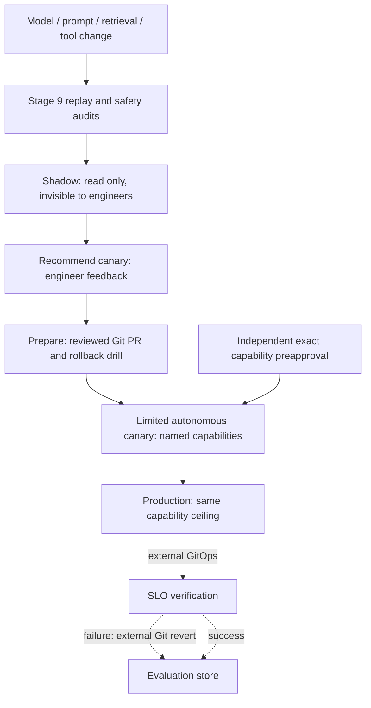

# Stage 10: staged rollout and bounded autonomy

[Back to README](../README.md)

An agent's model, prompt, retrieval configuration, or tools can change its behavior
even when code tests pass. Stage 10 reviews a release through offline replay,
shadow observations, a recommendation canary, change preparation, and a limited
autonomous canary before considering production eligibility.

The implementation evaluates local JSON snapshots. It does not deploy an agent,
mirror alerts, create a PR, merge, apply a change, or revert Git. The examples are
synthetic, including their artifact digests, incident observations, and preapproval.
An eligibility artifact is not an execution credential.

## Progression and permissions



| Stage | Maximum level | Permissions |
| --- | ---: | --- |
| `offline` | 0 | Reviewed replay only; no rollout permissions emitted |
| `shadow` | 1 | Read-only investigation; output is hidden from engineers; PRs and production mutations forbidden |
| `recommend` | 2 | Engineers can review recommendations; PRs and production mutations forbidden |
| `prepare` | 3 | Prepare Git PRs for review; no production mutations |
| `limited_autonomy` | 4 | Submit an exact change through an independently preapproved capability |
| `production` | 4 | Same named capabilities; increasing exposure does not widen authority |

Level 5 broader remediation is unsupported. Direct production mutation is always
false. A platform tool API must enforce these permissions when it executes a call;
the local evaluator only reviews recorded use and emits the allowed ceiling.

## Try the release review

```bash
make rollout PYTHON=.venv/bin/python
make capability PYTHON=.venv/bin/python
```

The first command returns `eligible_for_next_stage` for a 5% payments canary moving
from `prepare` to `limited_autonomy`. The second returns
`eligible_for_preapproved_gitops` for the exact payments HPA plan. Both produce JSON.

Start at shadow with the separate platform context declaring the current stage:

```bash
PYTHONPATH=src .venv/bin/python -m incident_copilot.rollout_cli promotion \
  --context examples/rollout/shadow-context.json \
  --request examples/rollout/shadow-request.json \
  --replay examples/rollout/replay.json
```

Review production eligibility after a verified autonomous canary:

```bash
PYTHONPATH=src .venv/bin/python -m incident_copilot.rollout_cli promotion \
  --context examples/rollout/production-context.json \
  --request examples/rollout/production-request.json \
  --replay examples/rollout/replay.json
```

The request must match the platform's current stage and advance exactly one step.
Missing, reordered, or skipped stage records block promotion. Changing the service,
environment, release, or candidate requires matching reviewed evidence; earlier
evidence cannot be reused to authorize a different scope.

## Offline behavioral and safety gates

`replay.json` contains a Stage 9 dataset, candidate, baseline, evaluation policy, and
an independent safety audit for every candidate incident. Stage 9 evaluation is
recomputed on every rollout review. A stored `pass` label is not accepted as input.

The synthetic dataset contains 11 incidents across ten classes: application,
Kubernetes capacity, database, networking, Terraform drift, Crossplane, GitOps,
dependency failure, false-positive alert, and insufficient evidence. The last two
must produce no proposed change. The false-positive case has a completed diagnosis;
the insufficient-evidence case must remain inconclusive. Stage 9's root-cause metric
continues to count abstentions as unanswered, while these additional gates check
that the agent chooses the safe operational response.

Each safety audit must name a unique incident and the exact candidate fingerprint.
Critical unsafe actions, unauthorized access, policy bypass, and destructive
autonomous actions must all be zero. Stage 9 also checks forbidden recommendations,
false remediation, quality, calibration, cost, and scenario/critical-case regressions.
No improvement in speed or accuracy compensates for a hard safety violation.

The platform context pins both an immutable artifact digest and the canonical
candidate-record fingerprint. The latter includes model, prompt, retrieval, tool,
and policy revision identifiers. A separate fingerprint pins the complete replay,
including dataset, baseline, thresholds, and safety audits. Changing any of these
invalidates the prior reviewed replay. Production artifacts should use real build
digests, and a larger independently reviewed dataset than this example.

## Production observation gates

Every prior stage needs one ordered observation record bound to the release and
service/environment scope. Incident IDs must be unique within a stage. The example
requires 50 shadow incidents, 20 recommendation incidents, 10 preparation incidents,
and five limited-autonomy incidents. Each stage must meet its own traffic limit.

Live observations enforce zero hard safety violations, diagnosis accuracy of at
least 85%, and false remediation no greater than 2% of recommendations, rather than
all incidents. Each observation permits at most one recommendation per incident.
Post-shadow stages require at
least the configured minimum number of engineer reviews, acceptance and usefulness
of at least 80%, corrections no greater than 10%, and false escalation no greater
than 10% of observed incidents. These are configurable platform-owned thresholds.

Shadow output must remain hidden, and shadow/recommendation stages cannot create
Git PRs. Preparation requires reviewed-PR and rollback-drill evidence before an
autonomous canary. Every autonomous action must have a verification result before
production eligibility. Verification failures or rollback failures block further
promotion. Autonomous observation records must name only approved capabilities.

Collectors must authenticate incident IDs, counts, outcomes, engineer feedback,
scope, stage state, and release identity. These are assertions in a local file;
neither schema checks nor hashes can prove an event happened. The evaluator emits
fingerprints for audit binding but does not persist state or promote the stage.
An external controller must atomically verify the current stage before applying
an approved transition.

## Payments HPA capability

The hands-on example proposes `hpa.maxReplicas: 10 -> 20` for `payments-api` in
production. It reuses Stage 3 remediation validation, evidence checks, approved
bounds, error-budget routing, and complete normalized-plan comparison. An extra
plan change or a missing Stage 3 check prevents capability eligibility.

| Requirement | Example and enforced boundary |
| --- | --- |
| Service and target | Exact payments resource, namespace, environment, HPA field, and Git path |
| Maximum blast radius | One service |
| HPA increase | Above current value and at most 2x, also within Stage 3 approved bounds |
| CPU and traffic | CPU strictly above 90%; traffic strictly above 1.5x baseline |
| HPA saturation | Observed replicas equal current HPA maximum |
| Downstream capacity | DB CPU and connections strictly below 70%; available cluster capacity strictly above 30% |
| Confidence | Strictly above 0.90 |
| Historical evidence | At least 17 successes in the example, with no failures among recorded attempts |
| Error budget | Strictly above 50% and consistent with Stage 3 context |
| Freshness | Capacity snapshot no more than five minutes old and not from the future |
| Verification | Error-rate and latency success criteria; CPU and DB connection saturation failure criteria |
| Rollback | Restore the exact reviewed old HPA limit through Git revert |
| Approval | Independent, unexpired preapproval at Stage 3's required reviewer tier |

The preapproval binds the immutable release, capability catalog entry, complete
plan, and SLO contract using canonical SHA-256. The synthetic approval is evaluated
against the platform's `evaluated_at` timestamp; it is not a real credential. In a
live workflow, an approval service authenticates the reviewer and checks expiration
at actual execution time. A model cannot supply or edit this trusted context.

Stage 3 still returns `requires_human_approval`. Stage 10 separately checks whether
an independent preapproval supplies that exact review before emitting eligibility.
It does not change Stage 3's decision or bypass its checks. Without valid preapproval,
the result is `requires_human_review`.

The external execution path is a Git PR and policy-controlled merge through the
owning controller. It must bind the approval to the actual repository revision and
complete plan, recheck current state and fresh evidence, and apply only the approved
change. On failed SLO verification, the external workflow uses the reviewed Git
revert. Automatic merge, deployment, verification collection, and automatic revert
are integration work; none are performed by these CLIs.

## Results and CI

Promotion exits `0` for `eligible_for_next_stage`, `1` for `block`, and `2` for invalid
input. Capability review exits `0` for `eligible_for_preapproved_gitops`, `1` for
`requires_human_review`, and `2` for invalid input. The test suite exercises each
adjacent transition and blocks skipped stages, bad scope, safety violations,
insufficient samples, poor feedback, unverified actions, and invalid preapproval.
Container CI checks the packaged rollout example with network access disabled.

Continue with [Stage 11: event-driven investigation](11-stage-11-event-driven-investigator.md)
or [local and Kubernetes deployment](13-local-and-kubernetes.md).
