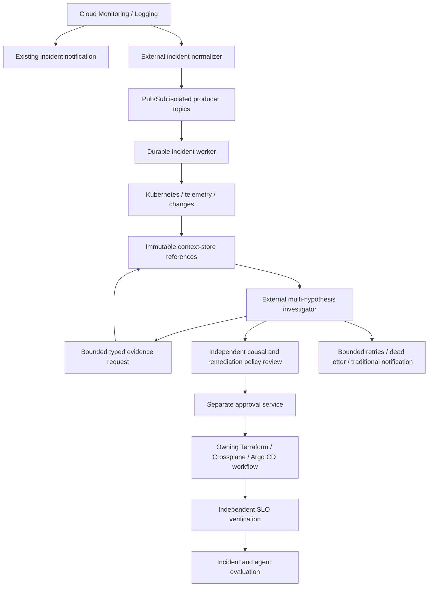

# Stage 11: event-driven incident investigator

[Back to README](../README.md)

This stage turns the local incident workflow into a durable event state machine.
Deterministic code gathers initial context, authorizes additional reads, binds
approval to reviewed artifacts, and records verification. Reasoning is a replaceable
external consumer. Monitoring and traditional paging remain independent.

## Run the examples

```bash
make events PYTHON=.venv/bin/python
# An independent, ephemeral run:
make events PYTHON=.venv/bin/python EVENTS_STATE=:memory:

# Three reported LLM timeouts: exits 1 and queues dead-letter + notification events.
PYTHONPATH=src .venv/bin/python -m incident_copilot.events_cli \
  --context examples/events/context.json \
  --deliveries examples/events/timeout-deliveries.json --state :memory:
```

The successful checkout fixture uses five reads and three reasoning rounds. It
localizes latency to pricing's database, records connections at 299/300 and a
recent Terraform limit reduction from 500 to 300, then proposes restoring the
reviewed configuration. Synthetic independent approvals, execution, and successful
SLO verification finish the replay at `resolved`. These are recorded fixture
attestations, not live observations or changes.

The default Make target stores state in `/tmp/incident-copilot-session11.sqlite3`.
Replaying identical events returns duplicate acknowledgments without requeuing
work. Use a new `EVENTS_STATE` path when changing context or experimenting; a
database is bound to its original configuration fingerprint. `/tmp` is suitable
for practice only. A durable deployment needs managed storage, access control,
backups, and explicit retention policies.

The CLI prints receipts, incident state, pending work, and an input audit. Exit
codes are `0` for a replay without escalation/retry, `1` for pending retries,
dead letters or failed/inconclusive verification, and `2` for invalid input/storage
errors. Exit `0` can describe an in-progress incident; inspect `phase` for completion.
Each delivery commits separately, so a later invalid delivery leaves earlier
committed deliveries intact.

## Flow and contracts



Every input and output carries `event_id`, `type`, `incident_id`, `trace_id`,
`agent_version`, timezone-aware `timestamp`, `source`, and `payload`. The first
event pins the incident's trace and agent version. IDs are stable across
redelivery. `trace_id` is nonzero lowercase hexadecimal with 32 characters.
Raw logs and full artifacts belong in a context store; payloads use immutable
references and SHA-256 digests. The default input limit is 16 KiB.

Four public [JSON Schema contracts](../schemas/events) cover `IncidentCreated`,
`EvidenceCollected`, `RemediationProposed`, and `RemediationVerified`. These describe
wire shape; the standard-library runtime additionally checks producer identity,
scope, configured limits, correlation, and lifecycle. They are JSON Schema documents,
not native Pub/Sub schema resources. Runtime contracts for every input live in
[`events.py`](../src/incident_copilot/events.py).

| Input | Required predecessor and resulting work |
| --- | --- |
| `incident.created` | Scoped breaching signal; queues exactly three deterministic collectors |
| `evidence.collected` | Matches a pending request; references distinct evidence; all pending reads must finish before reasoning |
| `hypothesis.updated` | Matches the active request and attempt; records 3–10 normalized competing beliefs and collected evidence IDs |
| `evidence.requested` | Follows an initial hypothesis update; authorizes a narrow read and decrements the remaining budget |
| `investigation.failed` | Matches active reasoning; schedules bounded retry or queues a dead letter and human escalation |
| `remediation.proposed` | Winning confidence above 0.90, recorded falsification, at least three cited collected facts; queues independent policy review |
| `remediation.approved` | Independent approval binds proposal ID, intent, full plan, and verification digests; queues reviewed GitOps execution |
| `remediation.executed` | Controller binds proposal, approval, plan, and full Git revision; queues SLO verification |
| `remediation.verified` | Verifier binds revision and verification contract; records outcome and requests evaluation |

The initial collectors are Kubernetes, telemetry, and change history. Progressive
tools are `get_service_health`, `get_dependency_health`, `get_recent_changes`, and
`get_cloudsql_health`. Targets must be in the platform-owned service/resource
catalog. Shell commands and cloud mutation primitives have no input contract.
The catalog selects the authoritative controller and repository path. The model
cannot select a controller, add an approval flag, or execute infrastructure changes.

The local worker checks lifecycle prerequisites. It does **not** infer causality
from a confidence score or verify a model's falsification claim. The external
policy/approval consumer must run Stage 8 causal checks and Stage 3 complete-plan
review using actual immutable artifacts and fresh evidence, enforce Stage 10
runtime scope, and bind its approval to the exact digests. The verifier must run
Stage 4 against independently collected observations; an investigator's `SUCCESS`
claim cannot stand in for verifier attestation. Fixture digests are synthetic
identities, and their referenced blobs are not supplied by this replay.

## Durability and failure behavior

[`EventOrchestrator`](../src/incident_copilot/event_orchestrator.py) commits inbox
deduplication, incident state, and pending output in one SQLite transaction before
returning an acknowledgment decision. A reused event ID with altered content is
rejected. Identical redeliveries return `duplicate`; a second trigger ID for the
same incident and trigger payload produces no additional fanout.

Out-of-order messages return `ack: false` with a future retry time. Early retries
do not advance the counter. The fixture allows three durable application attempts;
exhaustion queues `incident.dead_lettered` and `incident.notification_requested`.
Reasoning timeouts/unavailability/quota failures use a separate three-attempt
budget and exponential backoff. An external job runner must enforce the scheduled
`next_at` and deadline, apply a model-call timeout, and report failures. Late
results from an earlier timed-out attempt are rejected.

A five-minute investigation deadline and twelve-read budget bound the default
fixture. `expire(now)` detects silent collectors, missing callbacks, and stalled
reasoning without needing a new incoming event. A scheduler must call it
periodically using a trusted clock; the replay CLI can call it with `--sweep-at`.
Investigation deadlines close when a proposal enters review; execution and SLO
observation have their own external timeouts. Failed verification queues a reviewed
Git revert request and notification. Inconclusive verification requests human
investigation. Neither outcome applies a rollback.

The worker's outbox is local pending work, **not** a delivered notification or
Pub/Sub publication. A relay publishes committed events and calls `mark_published`
only after broker confirmation. A crash between publish and marking can duplicate
delivery: consumers must deduplicate IDs before side effects. Invalid schema,
identity, or artifact input raises `ValidationError` without advancing that event;
the authenticated adapter must persist a quarantine receipt or negatively acknowledge
for broker dead-letter handling. It must never acknowledge rejected events and
silently discard them. Monitor relay backlog and failures independently.

## GCP integration reference

[`deploy/gcp`](../deploy/gcp) defines six isolated ingress topics, pull subscriptions,
an outbox transport, a dead-letter topic and subscription, and scoped IAM. It is
a transport reference, not a deployed service. Validate and review it before any
separately authorized sandbox deployment. No cloud resources are needed for tests.

A live integration must provide:

1. A normalizer for [Cloud Monitoring notifications](https://docs.cloud.google.com/monitoring/support/notification-options).
   Raw notifications differ from this schema. Derive stable incident IDs, trace IDs,
   assigned agent version, service/environment, and comparable numeric signals
   through platform-owned mappings; do not parse human-readable summaries as authority.
2. Authenticated provenance per trust domain. Map configured isolated subscriptions
   to principals and audit all effective IAM. A consumer's identity or a message's
   `source` does not authenticate the original publisher. For push, validate the
   Google-signed token and endpoint authorization using Google's
   [push subscription guidance](https://docs.cloud.google.com/pubsub/docs/push),
   and preserve separate producer channels. `decode_pubsub_push` only decodes
   bounded base64 JSON; it authenticates nothing.
3. A transport listener, shared durable storage for multiple replicas, context-store
   access, collector clients, LLM job runner, scheduler, and idempotent outbox relay.
   Local delivery `principal` and `received_at` fields are fixture metadata; a
   production endpoint must obtain them independently of the request body.
4. Independent policy, Git/plan generation, human approval, controller execution,
   SLO collection/verification, evaluation, and notification consumers. The investigator
   identity must have no infrastructure mutation or approval credentials.
5. Independent alerts for AI availability, age of queued work, exhausted budgets,
   dead letters, and undelivered notifications. Preserve the existing pager route
   even if the orchestrator, model, bus adapter, or dispatcher is unavailable.

Pub/Sub's configured dead-letter attempts are best effort and range from 5 to 100;
they are separate from the worker's durable application counters. The reference
uses five transport attempts with service-agent forwarding permissions. See the
[dead-letter documentation](https://docs.cloud.google.com/pubsub/docs/dead-letter-topics).
Do not claim exactly-once side effects from local deduplication.

Continue with [local and Kubernetes deployment](12-local-and-kubernetes.md).
Session 12's GitOps PR risk reviewer is separate future work.
