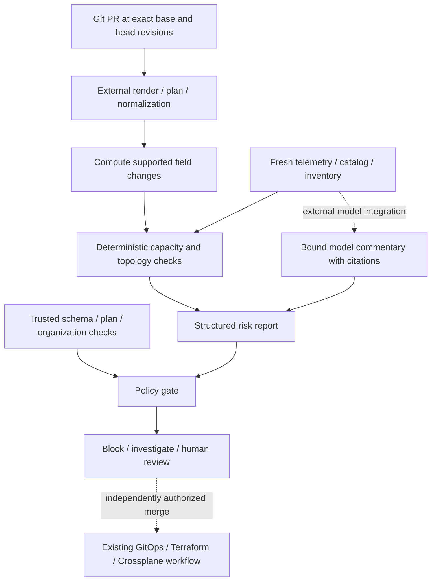

# Stage 12: GitOps PR risk reviewer

[Back to README](../README.md)

This stage screens desired-state changes against the way production actually
behaves. It computes a field diff from normalized resource snapshots, checks
operational invariants, and accepts an optional recorded model assessment with
resource-scoped evidence citations. It emits a review report; it never comments
on GitHub, merges a PR, or changes infrastructure.

## Run locally

```bash
# No known invariant violations; still requires a human reviewer. Exits 0.
make risk PYTHON=.venv/bin/python

# Five operational risk patterns with optional recorded model commentary. Exits 1.
PYTHONPATH=src .venv/bin/python -m incident_copilot.pr_risk_cli \
  --changes examples/pr-risk/unsafe-changes.json \
  --context examples/pr-risk/unsafe-context.json \
  --assessment examples/pr-risk/unsafe-assessment.json
```

The examples need no model API key, GitHub token, or cluster credentials. The
second example returns `block` with `critical` risk. Model commentary is optional;
the deterministic rules identify the same known violations without it.

With the image built using `make docker-build`:

```bash
docker run --rm --read-only --network none --cap-drop ALL \
  --security-opt no-new-privileges ai-incident-copilot:local \
  incident_copilot.pr_risk_cli \
  --changes examples/pr-risk/review-changes.json \
  --context examples/pr-risk/review-context.json
```

## Pipeline and trust boundaries



The local implementation consumes **normalized JSON projections**, not raw YAML,
Helm charts, Kustomize overlays, Terraform source, or raw provider plans. Trusted
adapters must render both revisions, validate schemas, obtain complete plans,
detect every changed resource and unsupported field, and normalize supported
updates. They must stop for unsupported changes instead of dropping them from a
projection. The runtime independently computes the supplied before/after field
diff and rejects unknown fields, duplicate resources, unsupported kinds, and
create/delete operations. Those cases need an adapter extension and manual review.

The context contains the exact candidate SHA-256, repository/environment, trusted
review time, maximum evidence age, storage reserve, preflight check results, and
an exact resource catalog. The catalog fixes kind, service, path, authoritative
controller, dependent services, SLO target, prior incident IDs, and evidence.
Kubernetes profiles use Argo CD, the Cloud SQL profile uses Terraform, and the
PostgreSQL claim profile uses Crossplane. These are explicit reference profiles,
not discovery of the resource's real ownership.

`schema`, `plan`, and `organization_policy` are externally collected statuses:
`pass`, `fail`, or `unknown`. A fingerprint binds them to the normalized candidate;
it is **not a signature or authentication**. Local files cannot establish whether
the normalizer, catalog, check result, or telemetry source is trustworthy. A live
adapter must authenticate provenance and keep policy/evidence outside model control.

## Supported operational screens

| Profile | Before/after fields | Required operational evidence | Rule |
| --- | --- | --- | --- |
| `HorizontalPodAutoscaler` | Minimum/maximum replicas and CPU target | At least 30 days of history, peak replicas, days exceeding the proposed cap, verified CPU signal | Block a reduced cap below observed demand; flag signal changes for review |
| `CloudSQLInstance` | Tier, CPU cores, memory GiB | Memory p95 and CPU p95/peak fractions | Block memory below p95; review CPU downsizing with a labeled linear screening estimate |
| `PostgreSQLInstance` | Storage GiB | Used storage and 30-day growth | Require `requested >= used + max(platform reserve, growth)`; review shrink semantics even above the floor |
| `NetworkPolicy` | One ingress peer's namespace `matchLabels` | Complete unique namespace inventory, labels, workload counts | Compute selected sets, additions/removals, and potentially added source workloads |
| `Deployment` | Replicas, effective per-pod CPU request, integer surge/unavailability | Current and ready replicas, current pod CPU request, cluster/node free CPU, autoscaler ceiling, PDB minimum | Check incremental steady-state demand, initial pod placement, and availability strategy separately |

All capacity units are explicitly normalized: CPU cores, GiB, and fractions in
`[0, 1]`. Provider tier-to-capacity lookup and pod request calculation are external
adapter responsibilities. Effective pod requests must account for all relevant
containers, initialization behavior, and overhead. Deployment percentage strategy
values must be converted to integer counts using Kubernetes rounding rules.
Network `matchExpressions`, pod selectors, ports, other ingress/egress rules, and
full effective policy composition are outside this single-peer profile.

Evidence must be no newer than the trusted review clock and no older than the
configured age (five minutes in the examples; maximum supported policy is one
hour). HPA history is a 30-day window ending at its snapshot time. Missing, stale,
future, short-window, or incomplete evidence produces `investigate` for the
affected resource. A known hard violation elsewhere still produces `block`.
CPU arithmetic also requires the observed Deployment baseline to match its
before projection and be fully ready; drift or an unhealthy baseline needs
investigation before estimating reclaimable CPU.

## What the blocked fixture demonstrates

- **HPA:** `maxReplicas` falls from 30 to 10, below the observed peak of 22;
  demand exceeded the proposed cap on 14 of the last 30 days.
- **Database:** 32 GiB becomes 16 GiB while memory p95 is 21 GiB. Three services,
  a 99.95% SLO target, and prior incident `INC-1928` provide operational context.
  Halving CPU gives a screening estimate of 1.58 times full utilization at peak;
  that estimate is a review aid, not a performance prediction or a hard policy gate.
- **Storage:** 300 GiB is below 437 GiB used plus a 30 GiB reserve. The
  deterministic safe floor is 467 GiB, independent of model judgment.
- **Ingress:** the selector changes from 3 checkout namespaces to 74 production
  namespaces. Set subtraction identifies 71 new namespaces containing 312
  potentially added source workloads. Equal-sized namespace replacements are
  also flagged, because counts alone can hide changed access.
- **Deployment:** twenty pods grow from 2 to 4 CPU each. Total requests rise
  from 40 to 80 cores, so **40 additional cores** fit within the reported 47 free.
  The fixture additionally reports only 3 free cores on the largest available
  node, an exhausted node autoscaler, and zero permitted rolling unavailability.
  No initial 4-core replacement pod fits under that snapshot. The report flags
  placement rather than incorrectly comparing 80 total cores with 47 free.

Namespace selection describes **potential** ingress sources. Effective
reachability depends on additive policies, caller egress, ports, and CNI
enforcement; see the [Kubernetes NetworkPolicy documentation](https://kubernetes.io/docs/concepts/services-networking/network-policies/).
The reviewer requests security and service-owner review rather than claiming
that every selected workload can now connect.

PDBs constrain voluntary evictions through the eviction API; they do not directly
limit Deployment rolling updates. Rollout availability is configured through the
Deployment strategy. The reviewer compares that strategy with the recorded PDB
target as an availability concern, never as a PDB-enforced rollout lock. See
[Kubernetes disruptions](https://kubernetes.io/docs/concepts/workloads/pods/disruptions/)
and [Deployment rolling updates](https://kubernetes.io/docs/concepts/workloads/controllers/deployment/#rolling-update-deployment).
The screens do not simulate scheduling, preemption, terminating pods, transient
surge usage, memory, quotas, affinity, taints, or a complete rollout. A clean
screen therefore still requires human review and service-specific validation.

## Model commentary and merge decisions

An optional `--assessment` carries `change_set_sha256`, `context_sha256`, and
findings with resource ID, severity, evidence IDs, explanation, and recommendation.
Citations must belong to that same changed resource's fresh usable evidence.
An old candidate, changed context, unrelated evidence, or an approval field is
rejected. Citation validation proves linkage, not that the prose is factually
entailed by the evidence. Model text stays untrusted and should be escaped by
any downstream renderer; the CLI never executes it or treats it as an instruction.

Deterministic findings and `model_findings` remain separate. Model severity can
raise the displayed risk, but a low-risk model claim cannot remove a hard finding,
satisfy missing evidence/checks, or approve a merge. A model-only concern goes to
human review; it cannot invent a new deterministic policy rule. Recurring risks
should become code and tests only after platform-team review, as the storage
capacity invariant does here.

| Decision | Meaning | Exit |
| --- | --- | --- |
| `block` | Failed preflight or a deterministic hard violation | `1` |
| `investigate` | Unknown preflight or inadequate evidence, with no known hard violation | `1` |
| `requires_human_review` | Supported changed resources have usable evidence and no hard violation | `0` |
| `no_change` | No supported fields changed and preflight checks pass | `0` |
| Invalid input | Contract, identity/binding, unsupported operation, or file error | `2` |

Every report includes repository/revisions, exact field changes, measurements,
evidence IDs, missing-context reasons, dependency/SLO/incident context, and
candidate/context/assessment/report fingerprints. `merge_authorized` is always
`false`. Exit `0` is successful evaluation, not merge permission. A GitHub check
adapter must inspect the decision and preserve any required human/security review;
branch protection and independent approval remain external.

The unit tests cover rule boundaries, stale evidence, incomplete inventories,
changed live baselines, candidate reuse, ownership substitution, and model attempts
to downgrade deterministic policy. Container CI checks both the human-review and
blocked examples without networking. LLM invocation, live collection, rendered
manifest/provider adapters, GitHub review posting, merge, and apply remain live
integration work. The existing response loop and Stage 11 orchestrator are unchanged.

Continue with [Stage 13: reliability knowledge graph](13-stage-13-reliability-knowledge-graph.md)
or [local and Kubernetes deployment](14-local-and-kubernetes.md).
